# PreJudge: get roasted before the judges do

**Live: https://3-82-224-157.sslip.io** · neatHack (Oct 10–12, 2026) · team QBITS

PreJudge is an AI agent that audits a hackathon submission before the real judges see it. Paste a
public GitHub repo URL and in about 5 seconds you get a judge-readiness score (0–100) mapped to the
official neatHack rubric, a fix list ordered by the points each fix is worth, and a short roast
that has to quote facts from your repo. Ask for the deep check and the agent downloads a read-only
copy of the repo, pulls the claims out of your README and tries to prove or disprove each one with
`file:line` evidence, then rescores. It never runs the audited code, and the README is never
accepted as proof of its own claims. The result is a shareable page with a roast card (PNG + link
preview).

> 🎬 **Demo video (≤ 3 min):** _link coming Monday, Oct 12_

## How it works

```mermaid
flowchart LR
    U[Repo URL] --> Q
    subgraph Q[Quick phase · about 5 s · at most 1 LLM call]
        G[GitHub API: repo, README, tree, commits, Entire refs] --> C[13 deterministic rubric checks]
        L[Link checker: SSRF-safe] --> C
        V[Video length from metadata] --> C
        C --> S1[Deterministic score] --> R1[Verdict + roast, fact-checked]
    end
    R1 --> P1[(SQLite: quick_ready)]
    P1 -->|Run deep check| D
    subgraph D[Deep phase · queued one at a time]
        T[Tarball, read-only, 30 MB cap] --> X[Extract README claims]
        X --> PS[Code pre-searches every claim]
        PS --> A[Agent tools: search_repo, read_file, list_files, get_commits, check_link]
        A --> J[Each claim: verified / unverified / contradicted + evidence]
        J --> S2[Rescore + capped estimates] --> R2[Final verdict]
    end
    R2 --> P2[(SQLite: complete)]
    P2 --> O[Result page, roast card PNG, /r/id link preview]
```



**Quick phase** (`backend/app/audit.py`): reads the repo through the GitHub API and runs 13
deterministic checks from `backend/app/tools/rubric.py`. They cover commits inside the hackathon
window, neatlogs in the dependencies, trace links, Entire checkpoints, the cfo.ai plan, demo video
length, building-in-public posts, before/after numbers, a failure-and-recovery run, dead links and
prompt injection. Then one LLM call writes the verdict and roast. The result is saved straight
away, so the deep phase never holds it up.

**Deep phase** (`backend/app/agent/loop.py`): downloads the repo tarball once (size-capped;
binaries, `node_modules`, vendored code, lockfiles, symlinks and path traversal are skipped),
extracts the README's claims and verifies each one with the agent tools in
`backend/app/agent/tools.py`. `search_repo` (`backend/app/tools/search.py`) returns `file:line`
snippets with context. A claim only counts as verified when the agent cites evidence it actually
saw in the code; citing the README is not enough. The failure-and-recovery check is judged here
too (`verify_failure_recovery()` in `rubric.py`): a described run, what failed and what the agent did
next, must be backed by a trace link, a screenshot in the repo, a log or retry/fallback code. The
quick phase never scores it, so no one loses points for what it can't read.

**Scoring** (`backend/app/scoring.py`) is plain code with the rubric weights: agent 30%, neatlogs +
Entire + cfo.ai 25%, demo video 20%, building in public 15%, usefulness 10%. The LLM never sets the
score. The two things code can't measure (agent quality, usefulness) get an LLM estimate that must
cite evidence. It is labelled "estimated" and capped at 80% of those points. When a check can't be
verified automatically (for example, no Entire checkpoints found), it isn't scored and its weight
moves to the rest of the category. That way PreJudge never takes points away for something it
couldn't see.

**Safety:** repo content is untrusted data in delimited blocks. Instructions hidden in a README
are detected, flagged on the result page and cannot move the score. Links are fetched behind an
SSRF guard: `_host_problem()` in `backend/app/tools/links.py` refuses any host that resolves to a
private, loopback, link-local (this includes the cloud metadata address 169.254.169.254),
reserved, multicast or unspecified address. Redirects are followed by hand, so every hop is
checked again.

**Running on the Groq free tier** (`backend/app/llm.py`): it rotates across models and schedules
calls from the rate-limit headers. On a failure, `_classify()` sorts the error (for example
`rate_limited` for a 429), and `_on_failure()` puts that model on a cooldown for as long as the
`retry-after` header says (read by `_retry_after()`). The call then moves to the next model,
recorded as an `llm.<purpose>.fallback` step. Other errors get exponential backoff with jitter. Deep checks wait for budget rather than drop to a weaker model. Failures are
recorded as steps, and the user always gets at least a partial report. Per-IP limits, a deep-queue
cap and a per-repo cooldown protect the shared budget (`backend/app/limits.py`).

## How we use neatlogs, Entire and cfo.ai

### neatlogs
Every audit is traced with the [neatlogs](https://neatlogs.com) SDK (`backend/app/tracing.py`):
each LLM call, tool call, retry, fallback and failure is recorded under the audit id as the session
id. Traces are tagged `real`/`test` and `prod`/`dev`, and secrets are masked before anything leaves
the process. The before/after numbers below come from these traces, and the M2 baseline's 16 failed LLM
calls showed up there too.

### Entire
Entire is enabled in this repo for Claude Code, and checkpoints are pushed to GitHub as
`refs/entire/checkpoints/...`.

- **Checkpoint ID:** `01M4NAH03T910P25SNH7F47SQC` (the `Entire-Checkpoint` trailer on commit `72021ab`)
- **Checkpoint link:** https://entire.io/gh/DurgaPritam/neatHack-QBITS-/commit/72021ab9bde0ea44f40c07637befa7d5228c1180
- Earlier Claude Code sessions (before Entire was enabled) were imported with `entire import
  claude-code` after a secret scan, so the whole build history is searchable.

We set this repo up following the [neatHack Entire guide](https://hack.entire.io/neathacks-2026/).
PreJudge also checks Entire for other teams: it reads the `Entire-Checkpoint` commit trailers and
the pushed `refs/entire/checkpoints` storage described in the
[Entire docs](https://docs.entire.io/guides/checkpoints/checkpoint-storage).

### cfo.ai
We built the business plan in cfo.ai: [shared model](https://cfo.ai/s/xBCsLLiMtconXUBf) ·
summary in [docs/business-plan.md](docs/business-plan.md).

- **Pricing:** monthly licenses at $199 / $499 / $999, pay-per-event audits at $49 / $149, and a
  free tier for individual teams.
- **Costs:** AI costs $0.0095 per audit, blended (measured in our traces: $0.005 quick, $0.02
  deep), and hosting is $20/month.
- **Revenue:** paid sales start Jan 2027. In the Main scenario that reaches $24,651/month by Sep
  2028 at a 97% gross margin.
- **Runway:** bootstrapped. The Main scenario is profitable every month from Feb 2027 and never
  runs out of cash (its lowest point is $1,748).

The model changed our decisions. Replacing a $0.40-per-audit AI guess with the measured cost moved
break-even 9 months earlier (v2 → v3).

## Evidence

All numbers come from real runs. Audit ids double as neatlogs session ids. The full log is in
[EVIDENCE.md](EVIDENCE.md).

### Before → after

Before → after on openai/swarm: first result in 52s before the two-speed redesign, 5.5s after it.

| Change (repo) | Before | After |
|---|---|---|
| M2 model + loop changes (openai/swarm) | 40,086 tokens, 106 s, 0 of 8 claims checked, 16 failed LLM calls | 19,066 tokens, 52 s, claims verified with `file:line` evidence |
| Two-speed audits: time to first result (openai/swarm) | 52 s | 5.5 s (quick phase, 4,094 tokens) |
| Tarball + `search_repo` + code pre-search: verified claims (huggingface/smolagents) | 1 of 8 | 6 of 8 (`b8e64c021d56`) |
| Quick phase capped at one LLM call (openai/swarm) | 4,094 tokens | 2,154 tokens, 5.5 s |
| Production, this repo (`29def6e19f64`) | — | quick 2,173 tokens / 5.3 s; deep 17,232 tokens / 40.5 s; 6 of 6 claims verified |

### Failure and recovery in production (audit `29def6e19f64`)

During the deep check of this repo, the claim-judging call `llm.verify` on `qwen/qwen3.8-27b`
**failed with a Groq 429 (rate limit)**. The agent backed off, retried on the fallback model
`openai/gpt-oss-120b` (3 calls, 9,018 prompt tokens) and finished the audit: 46/100 with 6 of 6
claims verified. The failed call is a recorded step on the public result page
https://3-82-224-157.sslip.io/a/29def6e19f64 and in the neatlogs trace for session `29def6e19f64`.

### neatlogs traces

Trace links (these need a neatlogs login, so screenshots follow):
[trace 1](https://app.neatlogs.com/traces/1458d983f3b529fecc4f3802366a96dc?orgId=c6ad6e53-b608-4914-80dd-1431f37951b6&projectId=91fff568-d321-45b8-83de-035100300128) ·
[trace 2](https://app.neatlogs.com/traces/b044efa9359e61ecef04ed7f61e9e216?orgId=c6ad6e53-b608-4914-80dd-1431f37951b6&projectId=91fff568-d321-45b8-83de-035100300128) ·
[trace 3](https://app.neatlogs.com/traces/c659bf9a4d3ef652dbc334dba40df89c?orgId=c6ad6e53-b608-4914-80dd-1431f37951b6&projectId=91fff568-d321-45b8-83de-035100300128)

> 📸 **SCREENSHOT TODO:** `evidence/neatlogs-failure-recovery-29def6e19f64.png`: the trace of
> audit `29def6e19f64` showing the 429 on qwen and the fallback to gpt-oss-120b.
>
> 📸 **SCREENSHOT TODO:** `evidence/neatlogs-trace-before-after.png`: an M2 trace next to an
> M2.5 trace (tokens and duration).
>
> 📸 **SCREENSHOT TODO:** `evidence/neatlogs-sessions-overview.png`: the session list with the
> `prod` tag.
>
> See [evidence/README.md](evidence/README.md) for how to embed them.

## Building in public

> 🔗 **#neatHack post links:** _to add_

## Run it yourself

```bash
cd backend && python -m venv .venv && .venv/bin/pip install -r requirements.txt
cp .env.example .env            # add GROQ_API_KEY, GITHUB_TOKEN, NEATLOGS_API_KEY
.venv/bin/uvicorn app.main:app --port 8000
cd ../frontend && npm install && npm run dev      # http://localhost:5173
```

- CLI: `cd backend && .venv/bin/python -m app.cli <repo_url> --full`
- Tests: `cd backend && .venv/bin/python -m pytest` (196 tests) and `cd frontend && ./e2e/run.sh`
  (Playwright, replay mode, no LLM tokens)
- Deploy: [DEPLOY.md](DEPLOY.md) (EC2, Docker Compose, Caddy HTTPS, daily backups)

## Repo layout

| Path | What's there |
|---|---|
| `backend/app/tools/` | GitHub client, rubric checks, link checker, repo search, video metadata |
| `backend/app/agent/` | deep-phase agent loop, prompts, claim schemas, roast rules |
| `backend/app/scoring.py` | deterministic scoring |
| `backend/app/main.py` | FastAPI routes, abuse limits, admin endpoints |
| `frontend/` | React + Vite + TypeScript UI, roast card export |
| `deploy/`, `scripts/` | Docker Compose, Caddyfile, server setup, deploy script |
| `docs/business-plan.md` | cfo.ai business plan summary |
| `EVIDENCE.md` | traces, before/after numbers, throughput, failure runs |
